# Companion Dock

A small Power-over-Ethernet box that connects USB Elgato Stream Decks to
[Bitfocus Companion](https://bitfocus.io/companion) over the network.

**Install it from your browser: <https://romansemkiv.github.io/companion-dock/>** (Chrome or Edge, the board on USB-C).

<p align="center">
  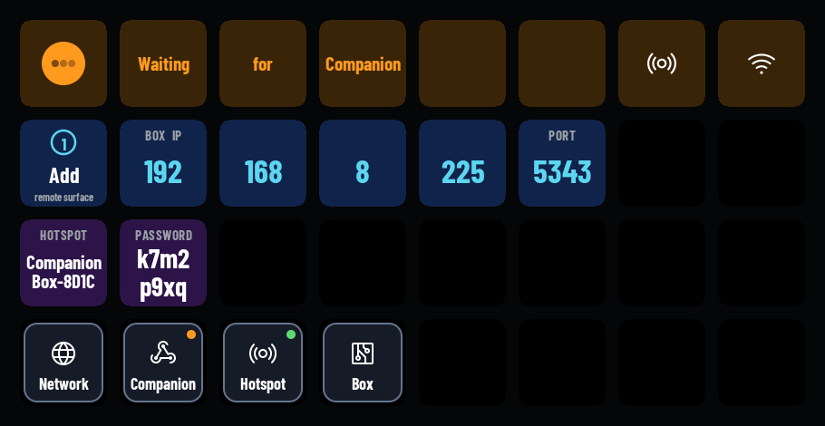
  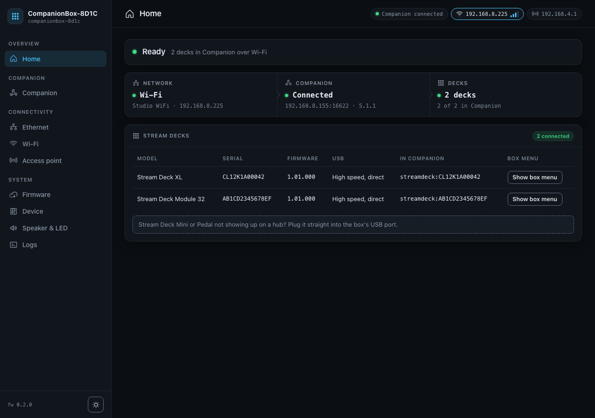
</p>

## Why

Companion drives Stream Decks well when they are plugged into the computer that runs it. On a stage, at a
lectern or in a control room down the corridor, that computer is often somewhere else. The usual answer is a
Raspberry Pi with a PoE HAT running Companion Satellite. It works, but it has an SD card, takes a while to boot
and needs looking after.

Companion Dock is firmware for a $25 ESP32-P4 board. One network cable gives it power and network. Plug the
decks into its USB port and Companion sees them as if they were plugged into the Companion machine. It starts in
about 5 seconds, has no SD card, and comes back by itself after power cuts, network outages and Companion
restarts.

There is no computer at the desk and nothing to log in to. Setup happens on the decks themselves and on a small
web page.

## Features

- **Two ways to connect.** *Network Dock* mode speaks Elgato's Network Dock protocol, so Companion adds each deck
  as its own remote surface and draws it with its own Stream Deck driver. *Satellite* mode speaks Companion's
  Satellite API: Companion finds the box and adds every deck by itself.
- **Every current USB Stream Deck**: Original, MK.2, Mini, XL, Module 6, 15 and 32, Stream Deck +, + XL, Neo
  and the Pedal. Each deck keeps its Companion page across replugs and reboots (it is known by its serial).
- **A box menu on the decks.** While Companion isn't driving a deck, the deck shows the box's own screens: the
  state, the box's address, Network, Companion, Hotspot and Box settings, with holds for anything that restarts
  or cuts people off. A key gesture or the web page opens the menu over Companion too.
- **A web page** for status, settings, firmware updates and the log, laid out for a phone as well as a desktop.
- **Ethernet and Wi-Fi**, with a backup Wi-Fi network for when the main one is out of reach, and a setup
  hotspot. The decks show QR codes to join the hotspot and open the setup page.
- **Firmware updates from the web page**, into two slots. A new image checks itself and the box rolls back if it
  fails. The other slot keeps a working copy as a recovery slot.
- **A settings PIN** (4 to 8 digits) that locks the web page and the decks' risky keys. On a deck, a PIN pad
  opens them.
- **Companion's Discover** can point a PIN-locked box at itself in Satellite mode (this can be switched off).
- **A speaker and a status light.** The board's speaker chimes when the box is ready and when Companion connects,
  and clicks on key presses; one NeoPixel shows the state in colour. *Find my box* beeps and blinks.

## Hardware and cost

| Part | Price | Notes |
|---|---|---|
| [Waveshare ESP32-P4-WIFI6-POE-ETH](https://www.waveshare.com/esp32-p4-wifi6-poe-eth.htm?sku=32832) | $24.99 | ESP32-P4 with 32 MB PSRAM, Ethernet, 802.3af PoE, an ESP32-C6 for Wi-Fi 6. Comes with a speaker, an antenna and cables |
| [Adafruit Breadboard-friendly RGB Smart NeoPixel (#1312)](https://www.adafruit.com/product/1312) | $7.95 for 5 | optional status light, SK6812 (WS2812B-compatible). You need one |
| A PoE switch or injector (802.3af) | | or USB-C power and Wi-Fi |

Prices from the vendors' sites, November 2026; shipping not included. That is about **$33** for the box itself.

The NeoPixel takes 5 V and GND from the board's header and its data input on GPIO 23, header pin 8 (another pin can be set on
the web page). Pin tables, power notes and the optional service button are in the
[manual](docs/manual.md#hardware).

### How many Stream Decks

The box has one USB-A port, so two or more decks go through a USB 2.0 high-speed hub. The firmware takes
**2 decks** by default and **4** at most: *Allow up to 4 decks…* on the web page's Device page. Every Elgato deck
counts, the Pedal too. How many you can really run depends on what powers them:

| The decks are powered by | Budget for the hub and the decks | Decks |
|---|---|---|
| PoE (802.3af), through an unpowered hub | about 1.5 A (7.5 W), what is left once the board has its share | **2** at full draw. 3 or 4 often work with the limit at 4, at your own risk |
| USB-C, a 5 V supply of 3 A or more (Wi-Fi only), through an unpowered hub | about 2 A, the USB-A port's current limit | **3** at full draw, 4 often |
| A powered hub (with its own power supply), the box on PoE or USB-C | the hub's supply | **4**, the firmware's maximum |

*Full draw* is 500 mA per deck, the most a deck asks for when it is plugged in (XL, Original v2). A Stream Deck + XL
is rated 900 mA and counts as almost two. An unpowered hub takes its own share from the same budget. With more than
the budget, the decks drop out or the box restarts.

These numbers are estimates from the ratings: the board's and the decks' real draw are still to be measured, and
hubs with several decks haven't been tested on a box yet. A full-speed deck (some Minis, the Pedal) doesn't work
behind a high-speed hub, so it only works plugged into the box directly, on its own.

### Case

A 3D-printable case in three lid variants: **Button** (a Choc key, wired as the service button, and a NeoPixel),
**LED** (a NeoPixel behind a diffuser) and **Slim** (a plain lid). One `.3mf` file per variant holds all its printed
parts, and an optional bracket mounts it under a desk or on a wall; the bill of materials, print settings, mounting,
assembly and wiring are in [case/](case/README.md).

<p align="center">
  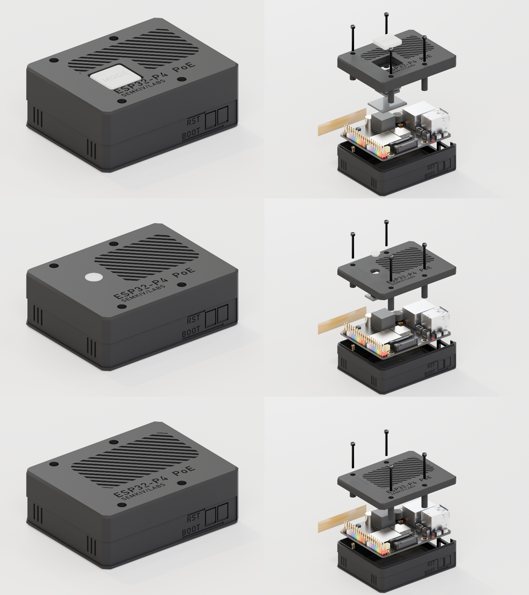
</p>

## Screenshots

### On the decks

| | |
|---|---|
| 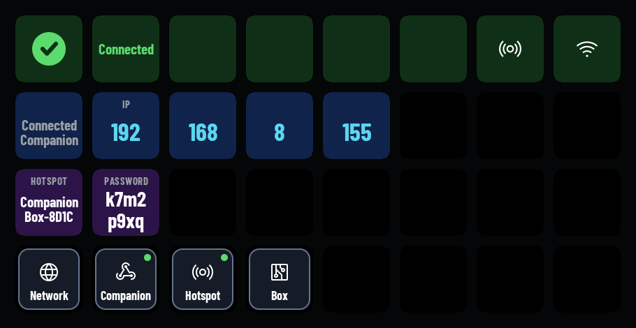 | 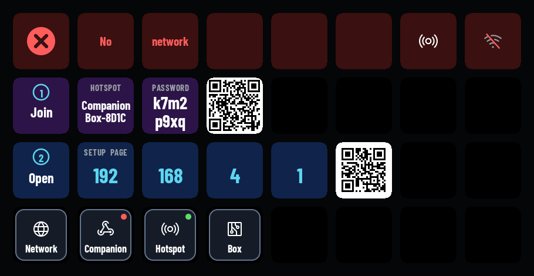 |
| Home, opened on demand while Companion is connected | No network yet: QR codes to join the hotspot and open the setup page |
| 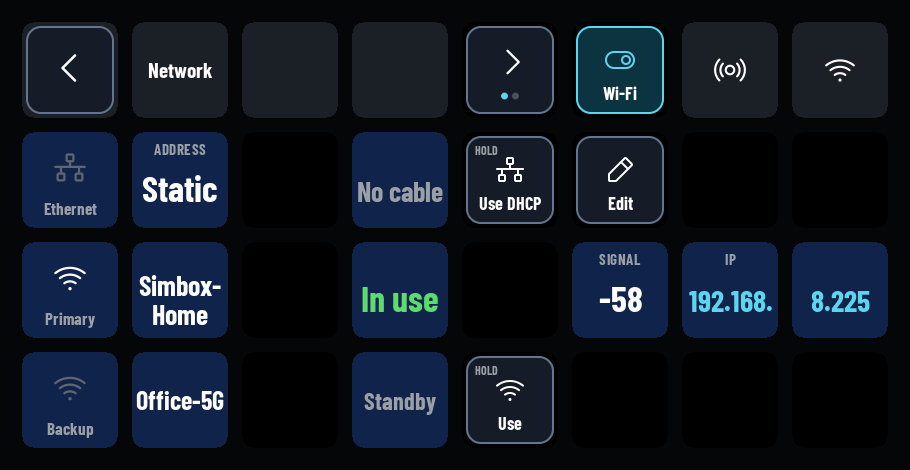 | 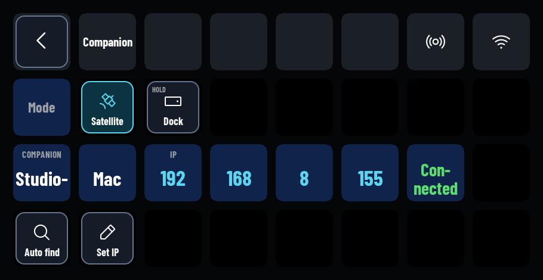 |
| Network: Ethernet, primary and backup Wi-Fi on a fixed key map | Companion in Satellite mode, with *Set IP* and *Auto find* |
| 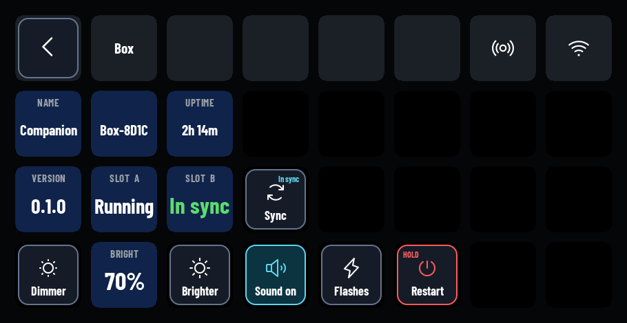 | 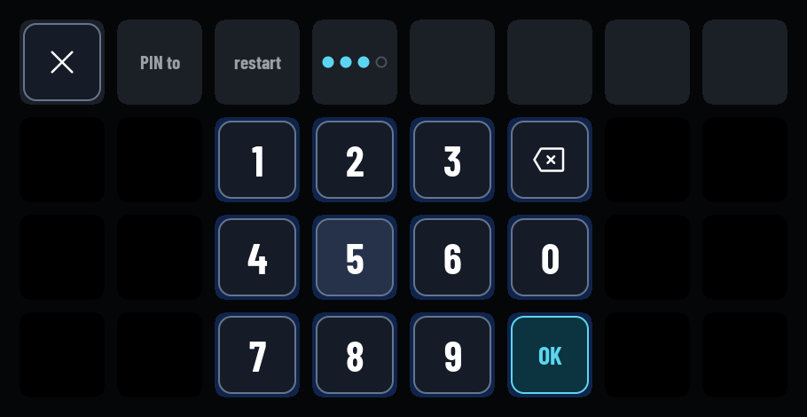 |
| Box: version, firmware slots, brightness, sound, restart | The PIN pad for locked keys |
| 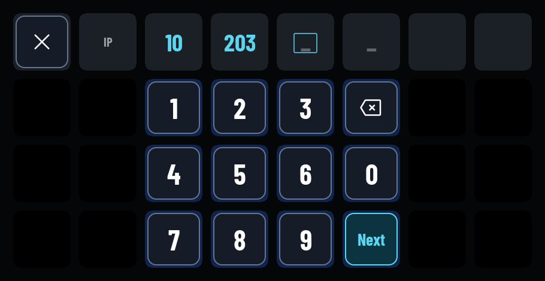 | 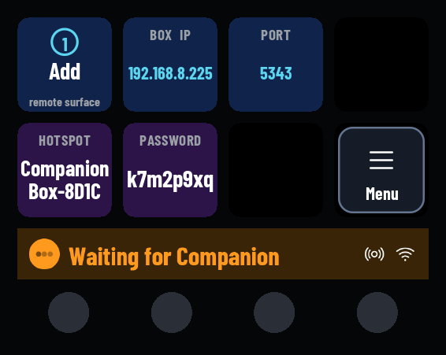 |
| XL: typing a static IP address | Stream Deck +: the status on the touch strip |
| 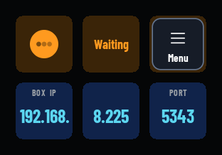 | |
| Stream Deck Mini: the same screens on 6 keys | |

### Web page

| | |
|---|---|
| 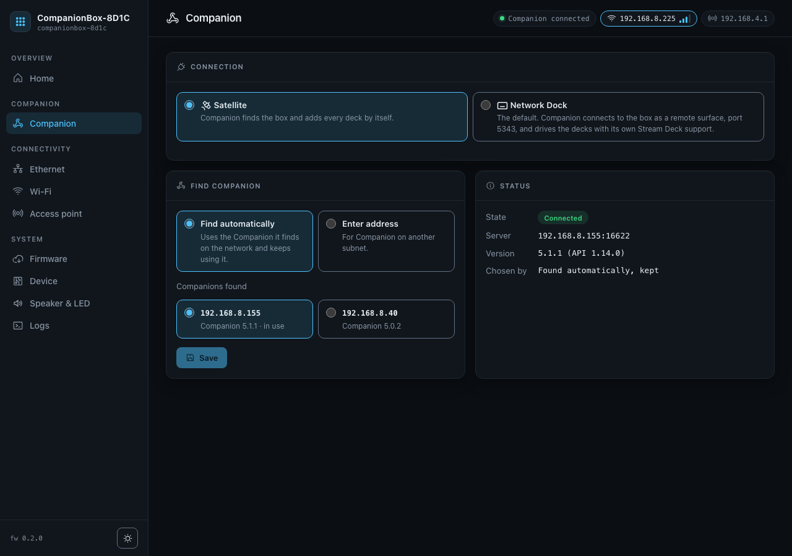 | 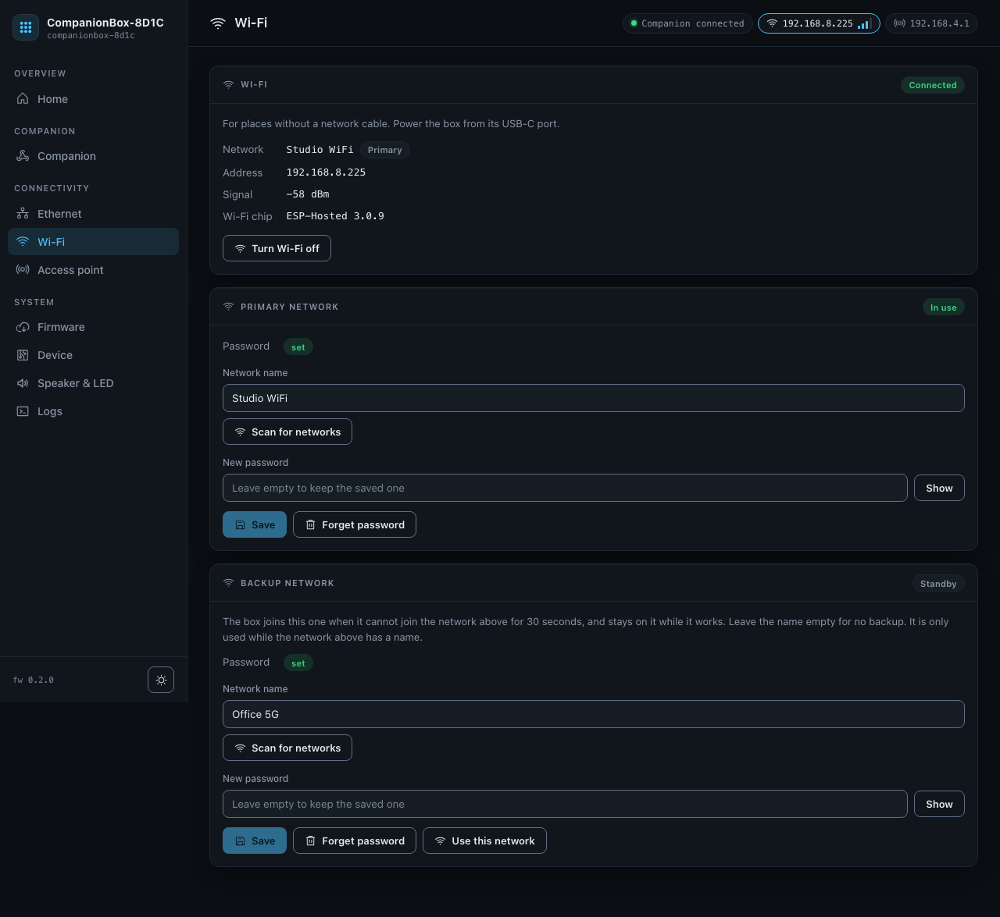 |
| Companion: the mode and how to find Companion | Wi-Fi: state, primary and backup networks |
| 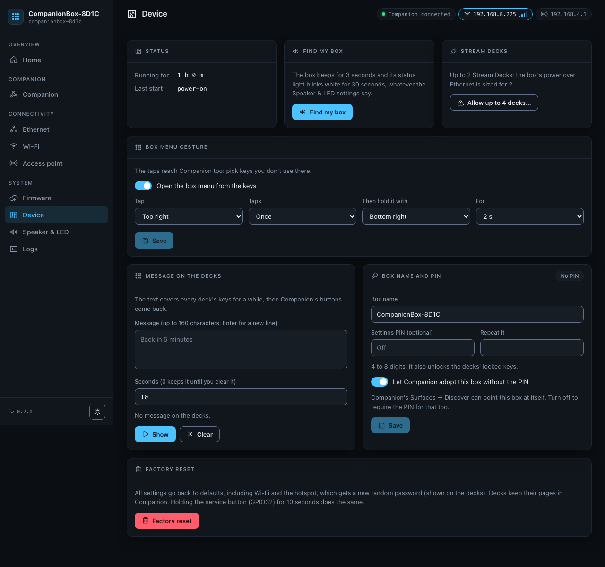 | 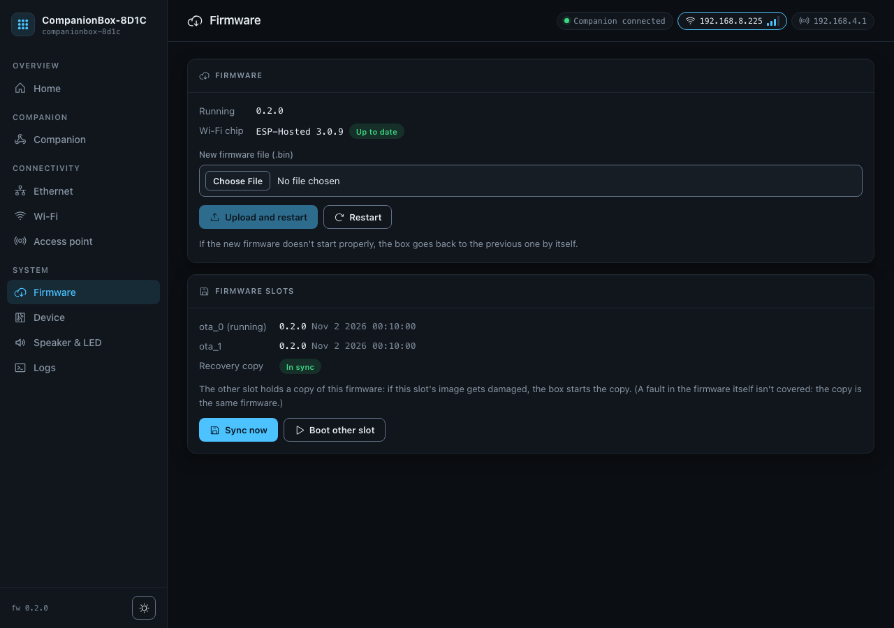 |
| Device: Find my box, deck limit, messages, box name and PIN | Firmware: upload, both slots, the recovery copy |
| 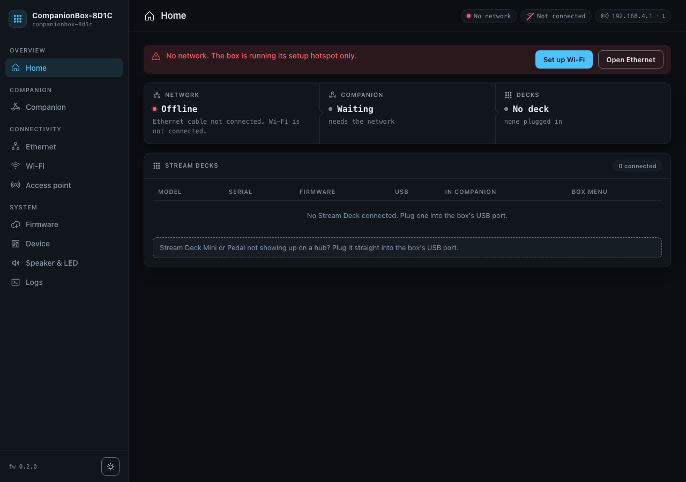 | 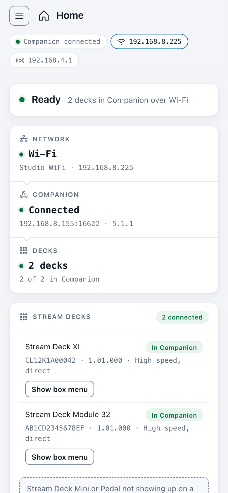 |
| First contact over the hotspot, before any network is set up | On a phone, light theme |

The top bar shows each connection with its own address; the one carrying the route is outlined:

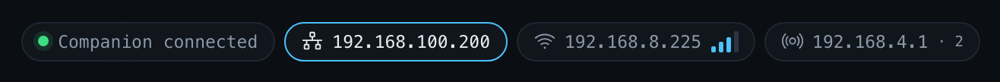

## Getting started

### 1. Flash the firmware

The easiest way is the browser installer at <https://romansemkiv.github.io/companion-dock/>. Open it in
Chrome or Edge, connect the board's USB-C port and press **Connect and install**. It fetches the latest firmware,
checks it, writes it and verifies it. Nothing to install.

From the command line, write the full image at `0x0` over the board's USB-C port:

```sh
python3 -m pip install "esptool>=4.12"
esptool.py --chip esp32p4 -p <PORT> -b 460800 write_flash 0x0 companion-dock-v0.2.2-full.bin
```

Or file by file:

```sh
esptool.py --chip esp32p4 -p <PORT> -b 460800 write_flash --flash_mode dio --flash_size 16MB --flash_freq 80m \
  0x2000 bootloader.bin 0x8000 partition-table.bin 0xf000 ota_data_initial.bin 0x20000 companion-dock-v0.2.2.bin
```

`SHA256SUMS` lists the checksums. [docs/flashing.md](docs/flashing.md) goes through it step by step, including a
way to flash from the browser with nothing to install.

The full image erases the settings. For a box that already runs this firmware, upload
`companion-dock-v0.2.2.bin` on the web page's **Firmware** page instead: the settings stay, and the box rolls back
if the new image doesn't start properly.

### 2. Set it up

Plug in the network cable (or USB-C power) and a deck. With no network yet, the deck shows two QR codes: scan the
first to join the box's hotspot, the second to open the setup page, and join your network from there. With
Ethernet and DHCP the box is on the network straight away, and the deck shows its address.

The web page is at `http://<box IP>/` or `http://companionbox-xxxx.local/`.

### 3. Add it in Companion

- **Network Dock mode** (the default): in Companion 5, *Surfaces → Remote → Add Remote Surface* with the box's
  IP and port **5343** for the first deck, **5345** for the second. Companion also lists the docks it discovers.
  The deck shows what to enter.
- **Satellite mode** (switch on the web page's Companion page): with one Companion 5 on the network, the decks
  appear by themselves. With several, pick one on the web page or on the deck. *Surfaces → Discover* in Companion
  also finds the box.

The [manual](docs/manual.md) covers the rest: [connection modes](docs/manual.md#connection-modes), the
[deck screens](docs/manual.md#maintenance-screens-on-the-decks), [recovery](docs/manual.md#recovery) and the
[API](docs/manual.md#api).

## Building from source

You need [ESP-IDF 5.5.6](https://github.com/espressif/esp-idf/releases/tag/v5.5.6), installed as in Espressif's getting-started guide.

```sh
. $HOME/esp/esp-idf-v5.5.6/export.sh   # or source tools/idf-env.sh, edited for your install
./build.sh                            # development build in build/
./build.sh -p <PORT>                  # build, flash and open the serial monitor
./build.sh --test                     # host unit tests and the web page checks
./build.sh --release                  # release build in build-release/, version from version.txt
```

The image carries the ESP32-C6's Wi-Fi firmware and keeps the C6 on it. `build.sh` builds that firmware first
(`tools/build_c6.sh`, into `build-c6/`) when it is missing or out of date, which needs ESP-IDF's component
registry once.

## Project layout

```
main/                 boot, the supervisor (settings, OTA self-check, watchdog), RESET x3, the service button
components/netmgr/    Ethernet, Wi-Fi station and hotspot through the C6, backup Wi-Fi, captive DNS
components/c6fw/      keeps the C6 on the ESP-Hosted firmware the image carries
components/discovery/ mDNS: announce the box, find Companion
components/satproto/  Satellite API codec and session (pure C, host-tested)
components/satclient/ the connection to Companion in Satellite mode
components/elgdock/   Network Dock mode: the dock servers and passthrough
components/usbdeck/   USB host, hubs, raw HID decks, recovery from stuck decks
components/deckmodel/ the deck models: geometry, image format, controls
components/deckproto/ Stream Deck HID reports
components/deckui/    the deck screens: layout per model, drawing, icons, QR codes, navigation
components/surfaces/  decks to Companion: images, input, messages, the box menu
components/webui/     HTTP server, WebSocket, JSON-RPC methods, the web page (www/index.html)
components/slotsync/  the recovery slot
components/feedback/  speaker and status light
test/host/            unit tests of the pure modules
tools/                build helpers, the page packer and checks, mock_box.py, dock_check
docs/                 the manual, the flashing guide, screenshots, the case renders (docs/img)
case/                 the 3D-printable case: one .3mf per variant (Button, LED, Slim) and the mount bracket
firmware/             prebuilt release files (the installer flashes them)
installer/            the browser installer (GitHub Pages: .github/workflows/pages.yml)
```

## Status and limitations

- On real hardware the box has run with the **Module 32** and the **XL**. The other models follow Elgato's
  documented protocol and Companion's own mapping, and their screens are checked in renders and host tests, but
  they haven't been on a box yet. Reports are welcome.
- Hubs and several decks at once haven't been verified on hardware yet. A full-speed deck (some Minis, the Pedal)
  doesn't work behind a high-speed hub, because the P4's USB host has no transaction translator; plug it into the
  box directly.
- **Power.** PoE alone runs **2 decks** at full draw, so the box takes 2 by default; the web page can allow **4**
  at your own risk, and a powered USB hub gives the extra decks their own power. The table is in
  [How many Stream Decks](#how-many-stream-decks). Real measurements are still to be done.
- **The hotspot** has a random password by default, and the decks show it, so anyone who can see a deck can join.
  It can be made open or turned off. Anyone on the hotspot or the network can change settings unless a settings
  PIN is set.

## Contributing

Issues and pull requests are welcome. Run `./build.sh --test` before sending a change; it builds every pure
module with warnings as errors, runs the unit tests and checks the web page.

To work on the web page without hardware, run the stand-in box and open <http://127.0.0.1:8080/>:

```sh
python3 tools/mock_box.py 8080           # or: python3 tools/mock_box.py 8080 dock
```

It serves `components/webui/www/index.html` with sample data in several states (listed at the top of the file).

## Licence

[PolyForm Shield 1.0.0](LICENSE): you may use, change and share the firmware for any purpose, at work too, except
to provide a product that competes with it or with Companion Dock (for example selling the firmware, a fork of it,
or devices that run it). For anything the licence doesn't cover, ask: open an issue. Third-party parts (the deck
font, icons, the QR code library, ESP-IDF and its components) keep their own licences: see
[THIRD_PARTY.md](THIRD_PARTY.md).

Not affiliated with or endorsed by Elgato / Corsair or Bitfocus AS. Elgato, Stream Deck and Network Dock are
trademarks of Corsair; Companion is a product of Bitfocus AS. The names only say what this works with, and the
Network Dock mode only speaks the same network protocol as Elgato's Network Dock.

Made by Roman Semkiv.
