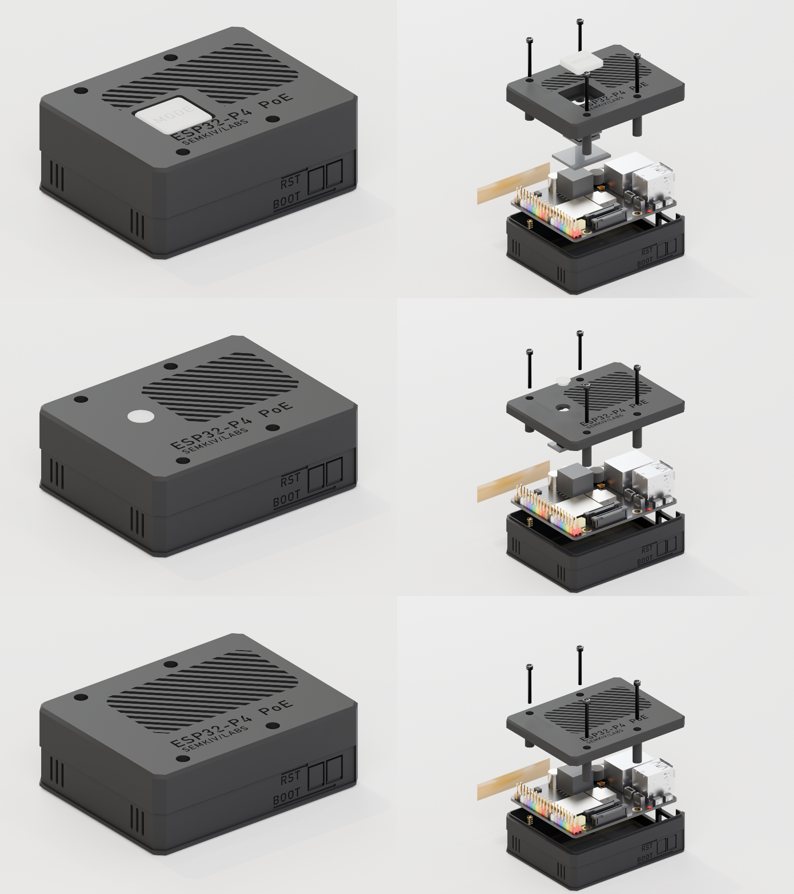
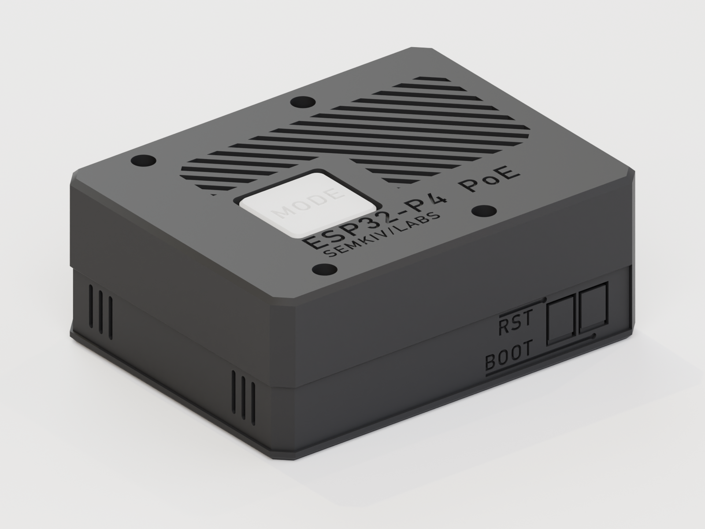
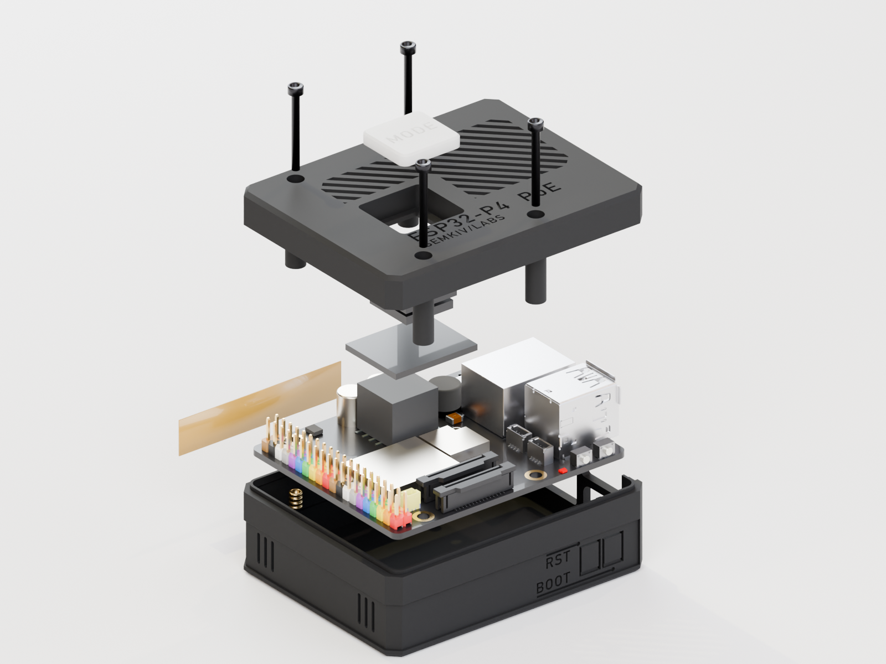
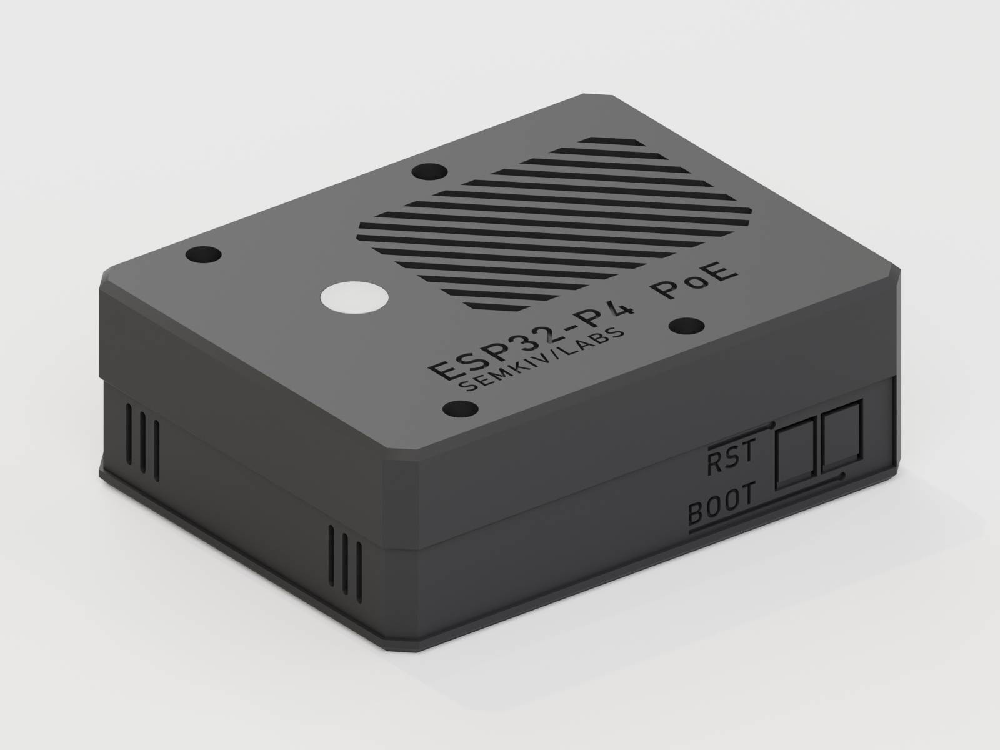
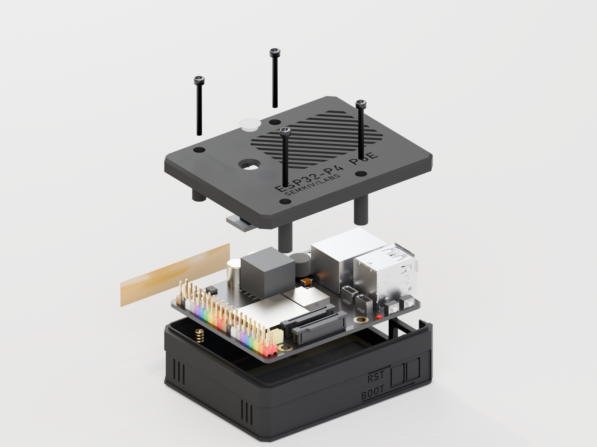
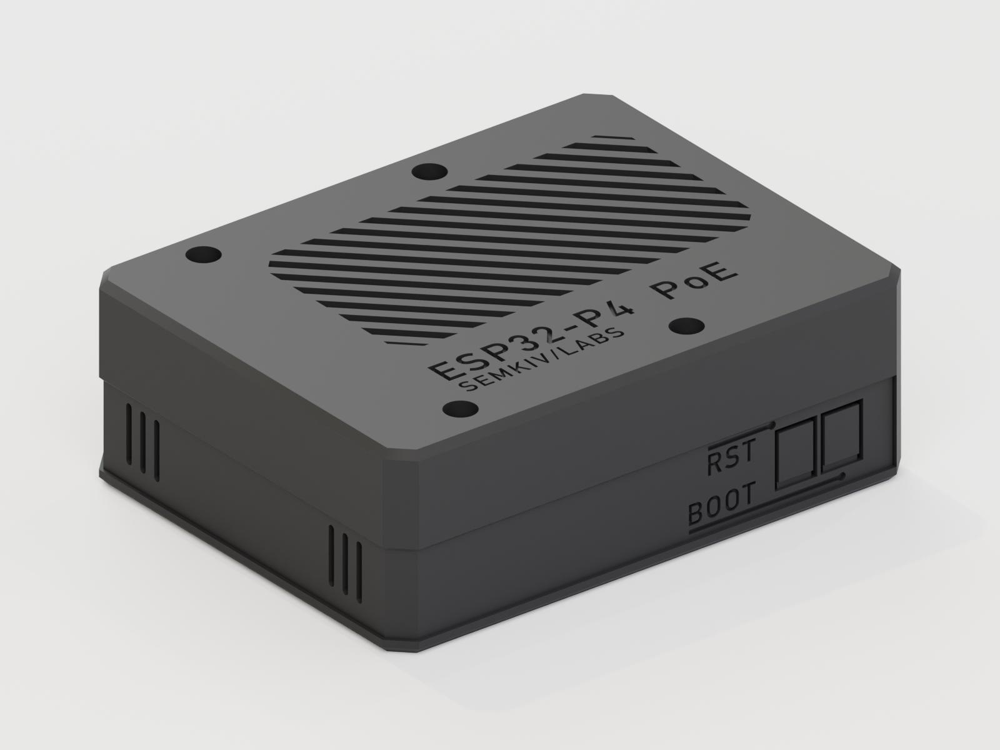
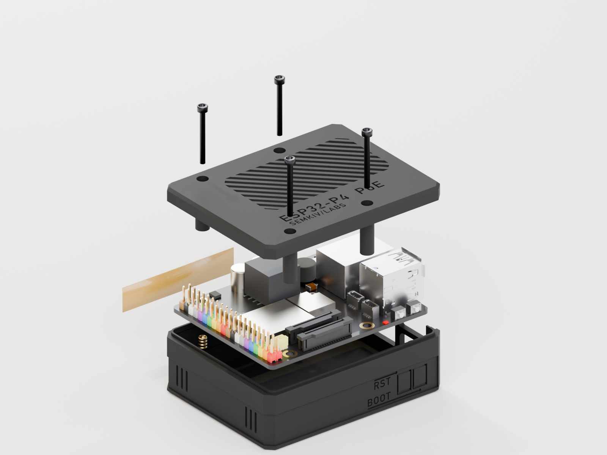
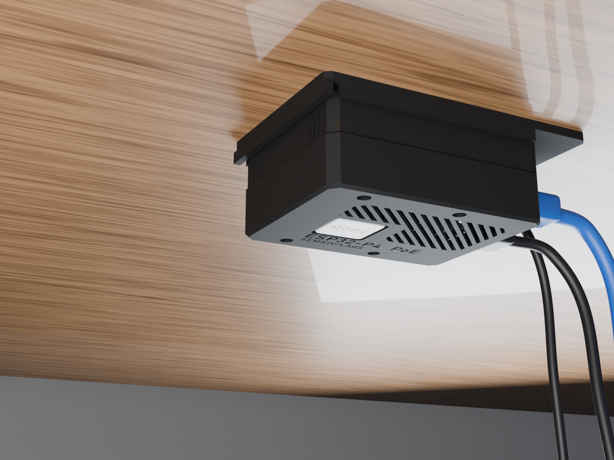
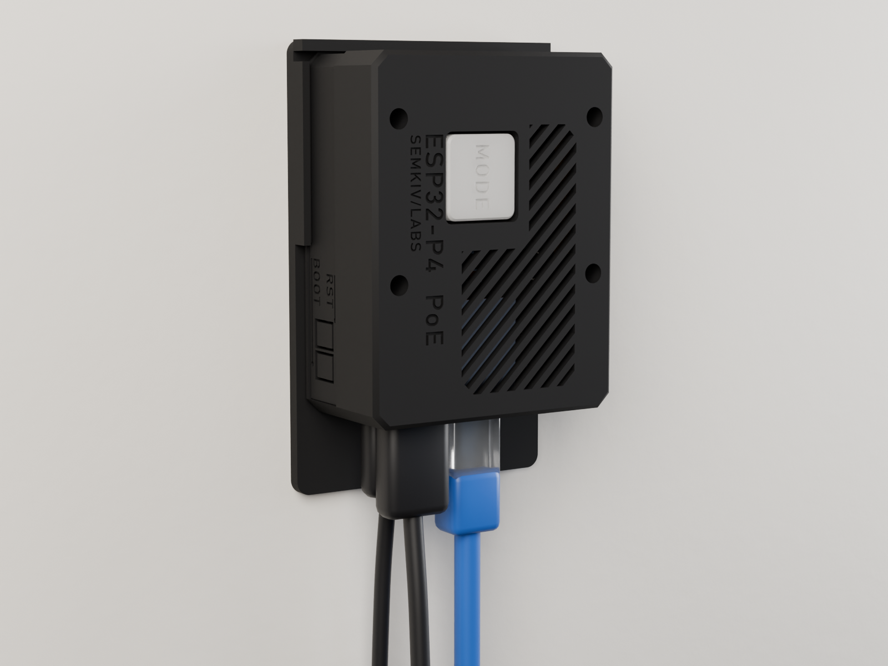

# Case

A 3D-printable enclosure for the Waveshare ESP32-P4-WIFI6-POE-ETH, the board Companion Dock runs on, in three lid
variants. All of them share the same base and screws; only the lid changes. Each `.3mf` file holds every printed part
of its variant, ready for the slicer.

| Variant | File | Assembled | Exploded |
|---|---|---|---|
| **Button**: a Choc v1 key with a NeoPixel, the keycap flush with the lid | [`ESP32P4_Case_BTN.3mf`](ESP32P4_Case_BTN.3mf) |  |  |
| **LED**: a NeoPixel status window with a light-pipe diffuser | [`ESP32P4_Case_LED.3mf`](ESP32P4_Case_LED.3mf) |  |  |
| **Slim**: a plain lid, no light or key | [`ESP32P4_Case_Slim.3mf`](ESP32P4_Case_Slim.3mf) |  |  |

## What's in each file

| File | Parts |
|---|---|
| `ESP32P4_Case_BTN.3mf` | base, Button lid, keycap, mount bracket (optional) |
| `ESP32P4_Case_LED.3mf` | base, LED lid, diffuser |
| `ESP32P4_Case_Slim.3mf` | base, Slim lid |
| [`ESP32P4_Case-MountBracket.3mf`](ESP32P4_Case-MountBracket.3mf) | the mount bracket alone (optional, for any variant; the Button file has it too) |

## Specs

| | Button | LED | Slim |
|---|---|---|---|
| Outside (L × W × H) | 75.7 × 59.0 × 30.0 mm | 75.7 × 59.0 × 26.5 mm | 75.7 × 59.0 × 26.5 mm |
| Top | Kailh Choc v1 key and NeoPixel (Adafruit NeoKey CHOC, #5756) | Adafruit #1312 NeoPixel behind a Ø6 mm diffuser | logo and grille |
| Extra printed part | keycap | diffuser | none |

Every variant has:

- **Ports:** cut-outs with chamfered lead-ins for USB-C, USB-A, the PoE RJ45 and the TF card, each one labelled.
- **Buttons:** flexure tabs over BOOT and RST, labelled on the wall.
- **Antenna:** a full-length pocket inside the +Y wall for a flex Wi-Fi antenna up to 70 × 10 mm (the C6 module has a
  U.FL connector).
- **Cooling:** a 45° grille in the lid.
- **Closure:** four M2 heat-set inserts with M2 × 20 socket-head screws from the top.
- **Mounting:** the optional slide-in bracket, for under a desk or on a wall.

The clearances were checked against Waveshare's 3D model of the board: no part of any variant touches the board. In
the LED and Slim lids the ceiling clears the USB-A port by 1.1 mm and the tops of Dupont plugs on the 40-pin header by
0.6 mm.

## Mounting

The optional bracket screws to a desk underside or a wall with two M3.5 / #6 countersunk screws. The case slides in
from the port end: lips on the bracket ride in a band on the base's sides, and a flex latch clicks it in place
against the rear stop. Press the latch to slide the case out.

| Under a desk | On a wall |
|---|---|
|  |  |

## Bill of materials

| Qty | Part | Variant |
|---|---|---|
| 1 | Waveshare ESP32-P4-WIFI6-POE-ETH | all |
| 4 | M2 × L4 × Ø3.2 heat-set insert | all |
| 4 | M2 × 20 socket-head cap screw | all |
| 1 | Flex Wi-Fi antenna, U.FL, up to 70 × 10 mm (optional) | all |
| 2 | M3.5 / #6 countersunk wood screw (for the bracket, optional) | all |
| 1 | Adafruit NeoKey Socket Breakout for CHOC (#5756) | Button |
| 1 | Kailh Choc **v1** switch (PG1350); not v2, not MX | Button |
| 1 | Adafruit NeoPixel Mini PCB (#1312) | LED |

## Printing

| Part | Orientation | Settings |
|---|---|---|
| Base | upright | PETG or ASA, 0.2 mm layers, 3 walls, 15 % infill, no supports |
| Lid (any) | top face down | as the base, no supports |
| Keycap, diffuser | as placed in the file (the keycap top face down) | natural or translucent PETG, 0.12 mm layers, 100 % infill |
| Bracket | flat | as the base |

The renders show matte black PETG with a white translucent keycap and diffuser.

## Assembly

1. Press the four heat-set inserts into the base posts.
2. Optional: stick the flex antenna into the +Y wall pocket and plug it into the C6 module's U.FL connector.
3. Place the board in the base; the ports line up with the openings in the end walls.
4. Fit the lid's light or key:
   - **Button:** clip the Choc switch into the lid from the top. Push the NeoKey board onto the switch pins from
     inside until both snap arms click. Press the keycap on.
   - **LED:** press the diffuser into the lid window from the top. Snap the #1312 board into its holder from inside;
     the crush ribs hold it.
5. Close the lid and fit the four M2 × 20 screws.

## Wiring for Companion Dock

To the board's 40-pin header (check the pinout of your board):

| What | Wire to | In the firmware |
|---|---|---|
| NeoPixel (Button and LED variants) | 5 V or 3V3, GND, data on **GPIO23** (header pin 8) | the status light's default pin (from 0.2.1; a box set up on an older firmware may keep GPIO26: choose GPIO23 under **Speaker & LED → Data pin**) |
| The key (Button variant) | **GPIO32** (header pin 25) and GND (pin 26) | the box's service button: a short press opens the box menu (or closes any open one), held 5 s it turns the setup hotspot on for 15 minutes, held 10 s it resets the box to factory settings ([Recovery](../docs/manual.md#recovery)). Internal pull-up, active low |

The firmware's service button is GPIO32 and can't be moved, so wire the key there rather than to another pin.

## Licence

The case files are part of Companion Dock and under the same licence: [PolyForm Shield 1.0.0](../LICENSE).
